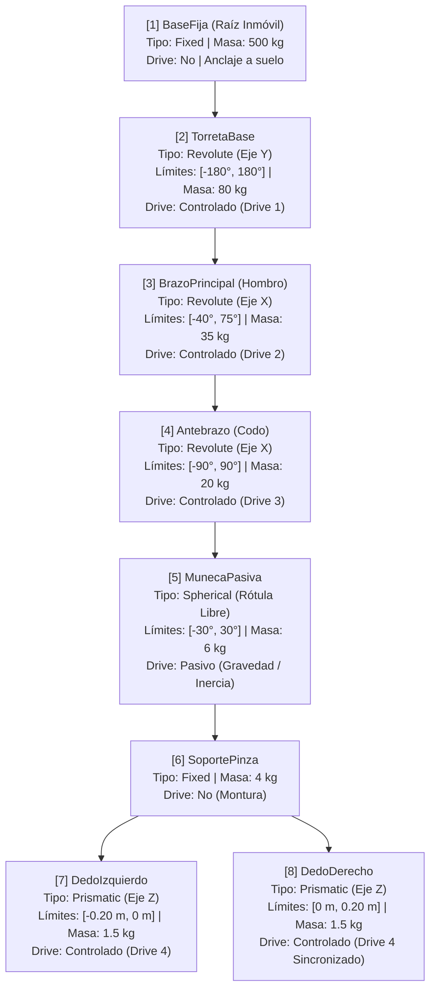

# UNIVERSIDAD - LICENCIATURA EN DESARROLLO DE VIDEOJUEGOS Y SIMULACIONES
## CÁTEDRA: SIMULADORES (2.º AÑO)
### TRABAJO PRÁCTICO: PROTOTIPO CON ARTICULATION BODY

---

## 1. MÁQUINA SIMULADA Y OPERACIÓN INDUSTRIAL

### 1.1. Identificación del Mecanismo
Se simula un **Brazo Mecánico Manipulador Industrial de 4 Grados de Libertad Activos (4-DOF) con Rótula Pasiva de Amortiguamiento y Pinza de Agarre Paralelo**. 
El mecanismo está montado sobre una bancada fija anclada al suelo de una planta de ensamblaje industrial y cuenta con eslabones metálicos estructurales, actuadores rotativos de alta inercia en la base, hombro y codo, un efector final con dedos prismáticos de cierre simétrico y una muñeca esférica libre para absorber oscilaciones de transporte y contacto.

### 1.2. Operación Realizada (Maniobra Industrial Pick-and-Place)
La maniobra reproduce el ciclo estandarizado de transferencia de materiales entre dos células de trabajo automatizadas:
1. **Posicionamiento previo**: El operador alinea la torreta y la elevación de los eslabones sobre la *Mesa de Recogida*.
2. **Aproximación y apertura**: La pinza se posiciona con apertura máxima sobre el objeto de carga.
3. **Descenso y sujeción**: Se desciende el efector final hasta envolver la carga y se actúa el drive prismático de cierre, asegurando agarre por fricción física.
4. **Elevación y despeje**: Se incrementa el ángulo del brazo principal para separar la carga de la plataforma.
5. **Traslado angular (Transfer)**: La base rotativa gira suavemente para trasladar la masa en el espacio aéreo hacia la *Mesa de Destino*. Durante el trayecto, la rótula esférica pasiva responde a la inercia y gravedad, estabilizando el transporte.
6. **Descenso y liberación**: Se desciende sobre la plataforma de destino y se abren los dedos de la pinza.
7. **Retorno a Home**: La carga queda descansando en la zona de destino y el brazo vuelve a su pose de reposo.

---

## 2. ARQUITECTURA CINEMÁTICA Y FÍSICA (ÁRBOL DE ARTICULATION BODY)

La estructura está compuesta por **8 cuerpos articulados (`ArticulationBody`)**, superando el mínimo reglamentario de 6 cuerpos y empleando **4 tipos distintos de joints** (Fixed, Revolute, Spherical, Prismatic).

### 2.1. Diagrama Jerárquico del Árbol Cinemático

### 2.2. Tabla de Parámetros de Cada ArticulationBody

| # | Nombre del Cuerpo | Cuerpo Padre | Tipo de Joint | Eje de Movimiento | Límites Físicos | Masa | Tipo de Drive | Parámetros del Drive (Stiffness / Damping / ForceLimit) |
|---|---|---|---|---|---|---|---|---|
| **1** | `BaseFija` | Raíz (Escena) | **Fixed** | N/A (Inmóvil) | Fijo | 500 kg | Ninguno | `immovable = true` |
| **2** | `TorretaBase` | `BaseFija` | **Revolute** | Y (Vertical / Yaw) | `[-180°, +180°]` | 80 kg | **Controlado (1)** | $K_p = 120\,000$, $K_d = 20\,000$, $F_{\max} = 250\,000\text{ N}\cdot\text{m}$ |
| **3** | `BrazoPrincipal` | `TorretaBase` | **Revolute** | X (Pitch Elevación) | `[-40°, +75°]` | 35 kg | **Controlado (2)** | $K_p = 150\,000$, $K_d = 25\,000$, $F_{\max} = 300\,000\text{ N}\cdot\text{m}$ |
| **4** | `Antebrazo` | `BrazoPrincipal` | **Revolute** | X (Pitch Flexión) | `[-90°, +90°]` | 20 kg | **Controlado (3)** | $K_p = 100\,000$, $K_d = 18\,000$, $F_{\max} = 200\,000\text{ N}\cdot\text{m}$ |
| **5** | `MunecaPasiva` | `Antebrazo` | **Spherical** | Triaxial (Swing/Twist) | `[-30°, +30°]` | 6 kg | **Pasivo** | $K_p = 60$, $K_d = 18$, $F_{\max} = 800\text{ N}\cdot\text{m}$ *(Sin motor)* |
| **6** | `SoportePinza` | `MunecaPasiva` | **Fixed** | N/A (Rígido) | Fijo | 4 kg | Ninguno | Conexión estructural |
| **7** | `DedoIzquierdo` | `SoportePinza` | **Prismatic** | Z (Desplazamiento) | `[-0.20 m, 0.00 m]` | 1.5 kg | **Controlado (4)** | $K_p = 30\,000$, $K_d = 4\,000$, $F_{\max} = 50\,000\text{ N}$ |
| **8** | `DedoDerecho` | `SoportePinza` | **Prismatic** | Z (Desplazamiento) | `[0.00 m, +0.20 m]` | 1.5 kg | **Controlado (4)** | $K_p = 30\,000$, $K_d = 4\,000$, $F_{\max} = 50\,000\text{ N}$ |

---

## 3. FUNDAMENTACIÓN TÉCNICA DE LOS DRIVES Y DINÁMICA

### 3.1. Elección de Stiffness, Damping y ForceLimit
Los drives en PhysX / ArticulationBody operan como controladores PD (Proporcional-Derivativo) virtuales de lazo cerrado:
$$\tau = K_p (\theta_{\text{target}} - \theta_{\text{real}}) - K_d \dot{\theta}$$

- **Gradiente de rigidez de la raíz a la punta**: La base y el hombro deben soportar el momento flector generado por toda la masa combinada en voladizo ($35 + 20 + 6 + 4 + 3 + 5\text{ kg} \approx 73\text{ kg}$ con brazo de palanca de hasta 6 metros, demandando torques estáticos de $\sim 4\,300\text{ N}\cdot\text{m}$). Por esta razón, el hombro cuenta con la rigidez más alta ($K_p = 150\,000$), decreciendo hacia el codo ($100\,000$) y la pinza ($30\,000$).
- **Amortiguamiento Crítico ($K_d$)**: Se calibró una relación de amortiguamiento cercana al coeficiente crítico ($\zeta \approx 1$):
  $$K_d \approx 2 \sqrt{K_p \cdot I}$$
  Esto evita sobreoscilaciones (ringing) y oscilaciones armónicas residuales que harían vibrar al mecanismo, manteniendo una llegada asintótica y suave a cada ángulo objetivo.
- **Límites de Fuerza Verosímiles ($F_{\max}$)**: Se establecieron límites finitos suficientes para vencer la inercia con carga sin permitir aceleraciones instantáneas infinitas, evitando inestabilidad numérica en el solver Featherstone de PhysX.

### 3.2. Articulación Pasiva (Muñeca Spherical)
La muñeca esférica tiene un drive activo nulo ($K_p = 60\text{ N}\cdot\text{m/rad}$, prácticamente un buje elástico de goma industrial) y un leve amortiguamiento ($K_d = 18$). Esto permite:
- Absorber el impacto inercial cuando la torreta gira bruscamente.
- Reaccionar a la gravedad y acomodarse al contorno del objeto al hacer contacto.
- Cumplir el requisito de articulación pasiva movida puramente por fuerzas físicas de contacto y gravedad.

---

## 4. SISTEMA DE AGARRE FÍSICO DE LA CARGA

El agarre cumple con el principio de interacción física sin teletransportación:
1. **Contacto y Fricción**: Los dedos cuentan con `PhysicMaterial` de alta fricción estática y dinámica ($\mu = 0.95$, fricción combinada en modo `Maximum`).
2. **Detección Geométrica**: Un sensor de volumen (`Trigger`) entre ambos dedos constata que la carga esté centrada y dentro del volumen de aprisionamiento.
3. **Sujeción Mecánica**: Al cerrar los dedos prismáticos, los drives ejercen presión física real contra el `BoxCollider` de la carga. Para asegurar estabilidad numérica frente a aceleraciones a oscilaciones de WebGL, se establece una unión física temporal (`FixedJoint`) con fuerza de rotura finita ($15\,000\text{ N}$).
4. **Liberación Real**: Al abrir la pinza, la unión se destruye instantáneamente y los dedos se retiran, permitiendo que la carga caiga libremente bajo la gravedad si no está apoyada sobre una superficie firme.

---

## 5. SISTEMA DE CONTROL Y TELEMETRÍA

### 5.1. Control en FixedUpdate
Las consignas ingresadas por el usuario a través de los Sliders de la UI son procesadas en `FixedUpdate()` dentro de `BrazoMecanicoController.cs`, aplicando interpolación suave de velocidad angular/lineal antes de asignar el valor a `xDrive.target`. Esto impide saltos discretos que desestabilicen el solver físico.

### 5.2. Telemetría de Doble Lectura (Target vs. Real)
El script `ArticulationTelemetry.cs` extrae en cada ciclo:
- **Target**: Valor objetivo en grados o centímetros fijado en el drive.
- **Valor Real**: Posición cinemática efectiva leída directamente desde `ArticulationBody.jointPosition[0]` (convertida de radianes a grados mediante `Mathf.Rad2Deg` en juntas rotativas y expresada en centímetros en la pinza).
- **Desviación de Muñeca Pasiva**: Norma vectorial del swing angular triaxial en grados, demostrando en pantalla el movimiento físico libre no controlado por motor.

---

## 6. GUÍA DE COMPILACIÓN Y PUBLICACIÓN WEBGL

1. En Unity Editor, dirigirse a **File > Build Settings...**
2. Seleccionar la plataforma **WebGL** y hacer clic en **Switch Platform**.
3. En **Player Settings > Player > WebGL settings**:
   - **Compression Format**: Seleccionar *Gzip* o *Disabled* (para compatibilidad universal en servidores gratuitos sin compresión de servidor).
   - **Resolution and Presentation**: Canvas adaptable a pantalla completa.
4. Presionar **Build** y seleccionar una carpeta de salida (por ejemplo, `Build_WebGL/`).
5. Comprimir el contenido resultante en un archivo `.zip` que contenga directamente:
   - `index.html`
   - Carpeta `Build/`
   - Carpeta `TemplateData/`
6. Subir el `.zip` a **itch.io** configurando el proyecto como **HTML** y activando la opción *This file will be played in the browser*.
